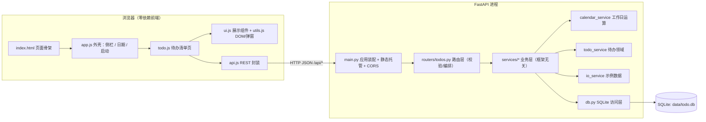
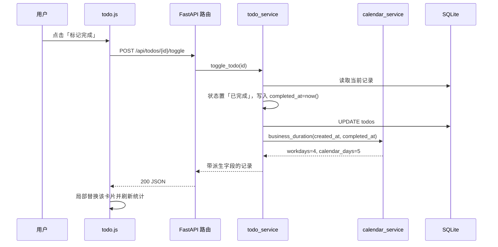
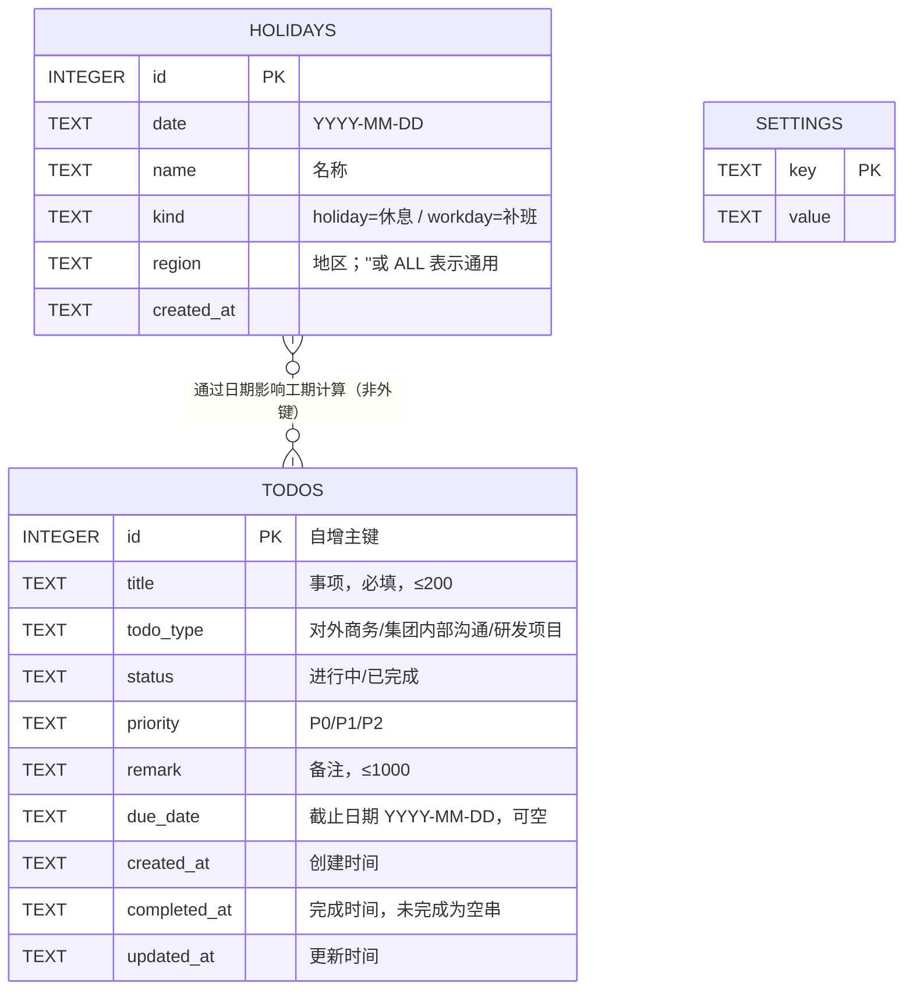

# 项目管理系统 1.0 · 待办清单 — 系统设计说明书

| 项 | 内容 |
|---|---|
| 系统名称 | 项目管理系统（PMS） |
| 本期范围 | **一期：待办清单**（其余菜单占位，二期开放） |
| 版本 | 1.0.0 |
| 架构 | 前后端分离（前端静态资源 + REST API） |
| 后端 | Python 3.11+ / FastAPI / Uvicorn |
| 前端 | 原生 JavaScript + CSS（零依赖、零 CDN） |
| 存储 | SQLite（Python 标准库 `sqlite3`，无 ORM） |
| 代码位置 | `todo-app/` |

---

## 1. 设计目标与取舍

| 目标 | 做法 | 原因 |
|---|---|---|
| 前后端分离 | 前端只通过 REST 调用 `/api/*`，后端开启 CORS | 前端可独立部署到 Nginx；后端可独立升级 |
| 离线可运行 | 不引入任何第三方前端库，后端只用标准库生成数据层 | 内网/离线机器上 `pip install` 一次即可长期运行 |
| 字段口径可集中调整 | 枚举、配色、长度限制集中在 `app/config.py`，前端经 `GET /api/meta` 获取 | 新增类型/优先级只改一处，不会前后端不一致 |
| 业务规则单一实现 | 所有业务规则只在 `app/services/*`；路由只做参数校验与编排 | 规则可单测（不依赖 HTTP），不会出现文档与实现不一致 |
| 可演进 | 数据库用 `PRAGMA user_version` + `MIGRATIONS` 列表；菜单/页面按模块拆分 | 二期加表加页面不需要重构 |

**明确不做（一期）**：登录鉴权、多用户与权限、附件、通知提醒、操作审计、分页（数据量预期很小）。
这些在 §9 给出了接入位置。

---

## 2. 总体架构



**分层职责**

| 层 | 文件 | 职责 | 不允许做的事 |
|---|---|---|---|
| 展示层 | `static/**` | DOM 渲染、交互、样式 | 不写业务规则；不直连数据库 |
| 接口层 | `routers/todos.py` | 参数解析与校验、错误映射、编排 | 不写业务规则 |
| 业务层 | `services/*` | 全部业务规则与校验 | 不感知 HTTP |
| 数据层 | `db.py` | 连接管理、DDL、迁移、通用查询helper | 不含业务语义 |

一次「标记完成」的调用链：



---

## 3. 数据模型

### 3.1 ER 图



> 一期 `todos` 与 `holidays` 无外键关系：节假日只参与「工作日」判定，二者通过**日期**发生业务关联，
> 不产生引用完整性约束。`settings` 存 `region` 等全局配置。二期新增 `projects` / `iterations` /
> `requirements` / `people` 后，`todos` 可加 `project_id` / `iteration_id` 外键（见 §9）。

### 3.2 字段与约束

| 字段 | 类型 | 必填 | 约束/默认 | 说明 |
|---|---|---|---|---|
| `id` | INTEGER | — | 自增主键 | |
| `title` | TEXT | ✅ | 非空，≤200 字符 | 不做字符白名单：中英文、数字、`「」— ≤ & <b>`、emoji 均原样保存 |
| `todo_type` | TEXT | ✅ | ∈ {对外商务, 集团内部沟通, 研发项目}，默认 `研发项目` | 非法值 400 |
| `status` | TEXT | ✅ | ∈ {进行中, 已完成}，默认 `进行中` | 非法值 400 |
| `priority` | TEXT | ✅ | ∈ {P0, P1, P2}，默认 `P1` | 非法值 400 |
| `remark` | TEXT | ❌ | ≤1000 字，默认 `''` | 前端有实时字数统计 |
| `due_date` | TEXT | ❌ | `YYYY-MM-DD` 或 `''` | 一期为增强项（逾期提醒） |
| `created_at` | TEXT | ✅ | 服务端 `now()` | 用户不可改 |
| `completed_at` | TEXT | ❌ | 完成时自动写入，退回进行中自动清空 | 用户不可直接改 |
| `updated_at` | TEXT | ✅ | 每次写入刷新 | |

**时间格式统一为 `YYYY-MM-DD HH:MM:SS` 字符串。**
理由：SQLite 无原生时间类型；该格式字典序 == 时间序，可直接用于 `ORDER BY` 与 `BETWEEN`，
前端切片 `slice(0,10)` / `slice(11,16)` 即可取日期与时分。

### 3.3 索引

为高频筛选/排序列建索引：`status`、`todo_type`、`priority`、`created_at`、`holidays(date)`。

### 3.4 迁移机制

```python
# app/db.py
MIGRATIONS = [(2, "ALTER TABLE todos ADD COLUMN project_id INTEGER REFERENCES projects(id)")]
```

启动时读 `PRAGMA user_version`，按序执行未应用的迁移并回写版本号；建表 DDL 幂等，
因此「空库初始化」与「老库升级」走同一入口 `db.init_db()`。

---

## 4. 核心业务规则

### 4.1 工作日与工期（`calendar_service`）

判定优先顺序：

```
holidays 表命中？
  ├─ kind='holiday' → 休息日（不算工作日）
  ├─ kind='workday' → 补班日（算工作日，即使周末）
  └─ 同一天两条记录 → 补班日优先
未命中 → 周一至周五算工作日，周六周日不算
```

`business_duration(start, end)`：

* 完成时间早于创建时间 → 按 0 处理（防御脏数据）；
* 否则 `workdays = count_workdays(start, end)`（**首尾两天都计入**），
  `calendar_days = (end - start).days + 1`；
* 复用 `holiday_map()` 一次性载入映射，避免逐日查库。

校验示例：2026-01-19（周一）→ 01-23（周五）= 5 个工作日 / 自然日 5；
2026-01-22（周四）→ 01-27（周二，跨周末）= 4 个工作日 / 自然日 6（已由测试覆盖）。

### 4.2 完成时间打点（`todo_service.update_todo`）

| 状态变化 | `completed_at` | 结果 |
|---|---|---|
| 进行中 → 已完成 | 写入 `now()` | 卡片显示「耗时 N 个工作日（自然日 M 天）」 |
| 已完成 → 进行中 | 清空为 `''` | 不再显示耗时，`workdays` 为 `null` |
| 已完成 → 已完成（改其它字段） | 保持不变 | 不会重复打点、不会重置工期 |

打点写在**服务端**而非前端，保证 API 直接调用（curl / 第三方集成）也有一致行为。

### 4.3 校验规则

| 规则 | 违反时 | 实现位置 |
|---|---|---|
| 事项必填、≤200 字 | 400 | `todo_service._validate` |
| 类型/状态/优先级必须为枚举值 | 400 | 同上 |
| 备注 ≤1000 字 | 422（pydantic）/ 400（service） | `schemas.TodoIn` + service 双保险 |
| 更新时只允许白名单字段 | 静默忽略非法字段 | `todo_service.FIELDS` 白名单 |
| 不存在的 id | 404 | 路由层 |

> 白名单机制同时消除了 SQL 注入面：列名来自代码常量，值一律参数化绑定。

### 4.4 派生字段（`decorate`）

列表/详情接口在记录上补充计算字段，前端不再算业务：

| 字段 | 含义 |
|---|---|
| `is_done` | 是否已完成 |
| `is_overdue` | 未完成 且 `due_date < 今天` |
| `is_due_today` | 未完成 且 `due_date == 今天` |
| `is_done_late` | 已完成 且 `completed_at > due_date` |
| `workdays` / `calendar_days` / `workdays_text` | 完成耗时（未完成时为 `null` / `''`） |
| `elapsed_workdays` | 未完成时「已进行」的工作日数 |

---

## 5. 接口设计

### 5.1 约定

* 前缀 `/api`，JSON 收发，UTF-8；
* 成功 `200`（新建 `201`）；错误统一 `{"detail": "中文原因"}`；
* 列表筛选参数均为可选，空值忽略；
* 分页：一期数据量小，提供 `limit`，未做 offset 分页（见 §9）。

### 5.2 接口清单

| 方法 | 路径 | 参数 | 说明 |
|---|---|---|---|
| GET | `/api/health` | — | 健康检查 |
| GET | `/api/meta` | — | 应用信息、枚举、配色、限制、计数（一次性给前端） |
| GET | `/api/counts` | — | 全局 + 按类型的未完成/总数 |
| GET | `/api/todos` | `status,todo_type,priority,q,sort,order,limit` | 列表 + 当前筛选的 `summary` + 全局 `counts` |
| POST | `/api/todos` | body | 新建 |
| GET | `/api/todos/{id}` | — | 详情 |
| PUT / PATCH | `/api/todos/{id}` | body | 局部更新（只改传入字段） |
| POST | `/api/todos/{id}/toggle` | — | 切换完成状态 |
| POST | `/api/todos/{id}/status` | `{status}` | 显式设置状态 |
| DELETE | `/api/todos/{id}` | — | 删除 |
| DELETE | `/api/todos` | — | 清空已完成，返回 `{deleted:N}` |
| GET | `/api/todos/summary` | 同列表筛选 | 统计条 + 逾期 Top5 |
| POST | `/api/demo/seed` | `{reset,force}` | 示例数据 |
| GET/POST/DELETE | `/api/holidays` | — | 维护休息日 / 补班日 |
| GET | `/api/calendar/workdays` | `start,end` | 区间工作日数 |

`sort` 支持 `created_at`（默认）、`completed_at`、`priority`、`due_date`、`title`、`workdays`；
`order` 为 `asc` / `desc`。**默认排序为 `created_at desc`（最新创建在最上面）**，
与需求「事项最新在最上面」一致；`priority` 排序按 P0→P1→P2 的语义序（`CASE` 表达式），
而非字符串序。同值用 `id` 做次级排序，保证结果稳定。

### 5.3 响应示例

```json
{
  "items": [
    {
      "id": 18, "title": "排期计算器支持法定节假日与补班日",
      "todo_type": "研发项目", "status": "进行中", "priority": "P0",
      "remark": "补班日必须算作工作日，否则上线日会整体前移一天。",
      "due_date": "2026-02-07", "created_at": "2026-02-03 13:45:00",
      "completed_at": "", "updated_at": "2026-02-03 13:45:00",
      "is_done": false, "is_overdue": true, "is_due_today": false, "is_done_late": false,
      "workdays": null, "calendar_days": null, "workdays_text": "", "elapsed_workdays": 3
    }
  ],
  "summary": { "total": 9, "doing": 5, "done": 4, "overdue": 4, "due_today": 0,
               "done_rate": 44, "avg_workdays": 4.5 },
  "counts": { "by_type": { "对外商务": { "pending": 1, "total": 2 } },
              "pending": 5, "total": 9 },
  "query": { "status": "all", "sort": "created_at", "order": "desc" }
}
```

---

## 6. 前端设计

### 6.1 模块划分

| 文件 | 职责 | 对外暴露 |
|---|---|---|
| `config.js` | 接口地址、全局状态（`Store`：meta/items/summary/counts/view）、视图偏好持久化 | `APP_CONFIG` `Store` |
| `utils.js` | DOM 构造 `h()`、日期/文本工具、Toast、Modal、确认框 | `U` |
| `api.js` | REST 封装、统一错误、查询串拼装 | `Api` |
| `ui.js` | 状态/优先级/类型标签、统计胶囊、进度条、空态、骨架屏 | `UI` |
| `todo.js` | 待办清单页：加载、卡片渲染、筛选、表单弹窗、完成/删除 | `TodoPage` |
| `app.js` | 外壳：侧栏菜单、日期卡片、启动编排 | — |

依赖方向单向：`app → todo → ui → utils`，`api` 被 `todo`/`app` 使用，无循环依赖。

### 6.2 视图状态

```js
Store.state.view = { status, todo_type, priority, q, sort, order }
```

* 单一数据源：所有筛选/排序都写回 `view`，再由 `load()` 统一请求后端；
* 变更后持久化到 `localStorage`（`APP_CONFIG.REMEMBER_VIEW`），刷新后保持偏好；
* 计数与页签数量始终来自后端 `counts`（**全局口径**），不随筛选变化——
  这样「进行中 3」在任何筛选下都表示真实总数，不会误导。

### 6.3 渲染策略

* **整页重建卡片**：`load()` 后重画卡片网格（状态简单、无虚拟 DOM 开销）；
* **局部更新**：`toggle` 成功后就地替换该卡片，避免整页闪烁；
* **事件委托**：卡片区只在 `#cards` 上挂一个 click 监听，用 `data-act`
  （`toggle`/`edit`/`del`）分派，避免为每张卡绑定多个监听；
* **空态区分**：区分「一条数据都没有」（引导新建/载入示例）与「筛选无结果」（引导重置条件）。

### 6.4 安全（XSS）

事项与备注是自由文本，渲染时：

* 普通文本走 `textContent`（`h(..., {text})`）；
* 需要高亮搜索词时走 `escapeHtml()` + `<mark>`，**先转义再插标签**；
* `remark` 的摘要同样经 `highlight()` 转义。

因此 `事项 = ` 会原样显示为文字，不会执行（前端测试已断言）。

### 6.5 响应式

* ≥1080px：卡片自适应多列网格；
* ≤860px：侧栏变抽屉（`☰` 切换）、卡片单列、筛选条换行铺满。

---

## 7. 关键设计决策记录（ADR）

| # | 决策 | 备选 | 理由 |
|---|---|---|---|
| 1 | 用 SQLite + 标准库 `sqlite3`，不用 ORM | SQLAlchemy / Django ORM | 一期单表、部署简单；`db.py` 已隔离，换库只改一处 |
| 2 | 每次调用开短连接 | 全局长连接 / 连接池 | 与 FastAPI 线程池天然兼容；SQLite 本地文件开销极低 |
| 3 | 业务规则集中在 service，路由极薄 | 逻辑写在路由 | 规则可脱离 HTTP 单测；README/接口文档不会与实现漂移 |
| 4 | 枚举与配色由 `/api/meta` 下发 | 前端硬编码 | 新增类型/优先级只改 `config.py` |
| 5 | 完成时间打点在服务端 | 前端提交 | 保证 curl/第三方调用行为一致 |
| 6 | 时间存字符串 | 存 Unix 时间戳 | 人可读、字典序即时间序、便于 SQL 比较与前端切片 |
| 7 | 前端零依赖 | Vue/React + 构建链 | 离线机器可运行；无构建步骤，改完刷新即生效 |
| 8 | 前端测试自建最小 DOM | 引入 jsdom | 不增加 npm 依赖，且直接解析真实 `index.html`，结构不失真 |

---

## 8. 测试设计

| 层次 | 文件 | 用例 | 覆盖 |
|---|---|---|---|
| 后端 | `tests/test_todo_api.py` | 21 | 元数据口径、页面与 `/docs` 可访问、CRUD、默认值与枚举校验、必填与长度、局部更新、404、工作日规则、工期计算、打点与回退、逾期标记、筛选/排序/搜索、计数与统计口径、示例数据幂等 |
| 前端 | `tests/test_frontend.mjs` | 25 | 卡片渲染与语义（`article.card`）、侧栏日期与计数、统计胶囊、页签数量、优先级/状态配色、完成耗时文案、逾期标记、类型标签、XSS 转义、事件委托（完成/删除）、页签与优先级筛选、搜索高亮、空态与重置、表单弹窗字段与 1000 字限制、侧栏类型计数、二期菜单禁用 |

前端测试的两个要点：

1. **用真实的 `index.html` 构建 DOM**（轻量解析标签与属性），避免测试里的结构与
   真实页面不一致而产生「假绿」；
2. **异步用例串行 await + 条件等待**（`waitFor`），不用固定 `sleep` 断言，
   避免用例互相抢跑。

> 开发过程中，这套前端测试实际抓出一个真实缺陷：`modal()` 用 `appendChild` 追加
> footer，而 footer 回调返回的是按钮**数组**，导致弹窗底部按钮在真实浏览器里无法渲染。
> 已修复为数组安全的 `append()`。

---

## 9. 二期扩展点

| 能力 | 接入位置 | 做法要点 |
|---|---|---|
| 迭代排期 / 需求 / 人员 / 看板 | `routers/` 新增路由文件 + `services/` 新增领域服务；前端 `MENUS` 去掉 `disabled` 占位并新增 `static/js/pages/*.js` | 一期分层已按此预留，无需重构 |
| 待办关联项目/迭代 | `MIGRATIONS` 追加 `ALTER TABLE todos ADD COLUMN project_id/iteration_id` | 迁移机制已就绪；保持 `ON DELETE SET NULL` |
| 登录与权限 | `main.py` 增加认证依赖（`Depends`）+ `todos` 加 `owner_id` | 一期所有接口都无鉴权，需在路由层统一加 |
| 附件 | 新增 `attachments` 表 + 上传接口，静态目录挂 `/uploads` | |
| 通知提醒（到期/逾期） | 新增后台任务读取 `due_date`，复用现成的 `is_overdue` / `is_due_today` 口径 | 口径已集中在 `todo_service.decorate` |
| 大数据量分页 | `list_todos` 增加 `offset`/游标，接口返回 `total` | 现有 `limit` 参数已预留 |
| 精确节假日数据 | 维护 `holidays` 表（已有 REST 接口）或接入年度数据初始化脚本 | 工期算法无需改动 |
| 操作审计 | 新增 `audit_log` 表，在 service 写操作处统一记录 | service 是唯一写入口，埋点集中 |

---

## 10. 部署与运维

```bash
python -m pip install -r requirements.txt
python run.py --host 0.0.0.0 --port 8000
```

* 生产建议用 Uvicorn/Gunicorn 多 worker 或 systemd 托管，前置 Nginx 反向代理 + HTTPS；
* 前端可与后端同源部署（默认），也可把 `app/static` 单独放到静态服务器，
  在前端 `js/config.js` 配置 `API_BASE` 指向后端；
* **数据备份**：直接复制 `data/todo.db`（WAL 模式下建议同时复制 `-wal`/`-shm` 或用
  `VACUUM INTO`）；因是单文件，备份与迁移成本极低；
* 健康检查：`GET /api/health` 返回 `{"status":"ok"}`，可用于探针。

**上线前需收紧**：`main.py` 的 CORS 当前为 `allow_origins=["*"]`，应按实际前端域名收敛。
